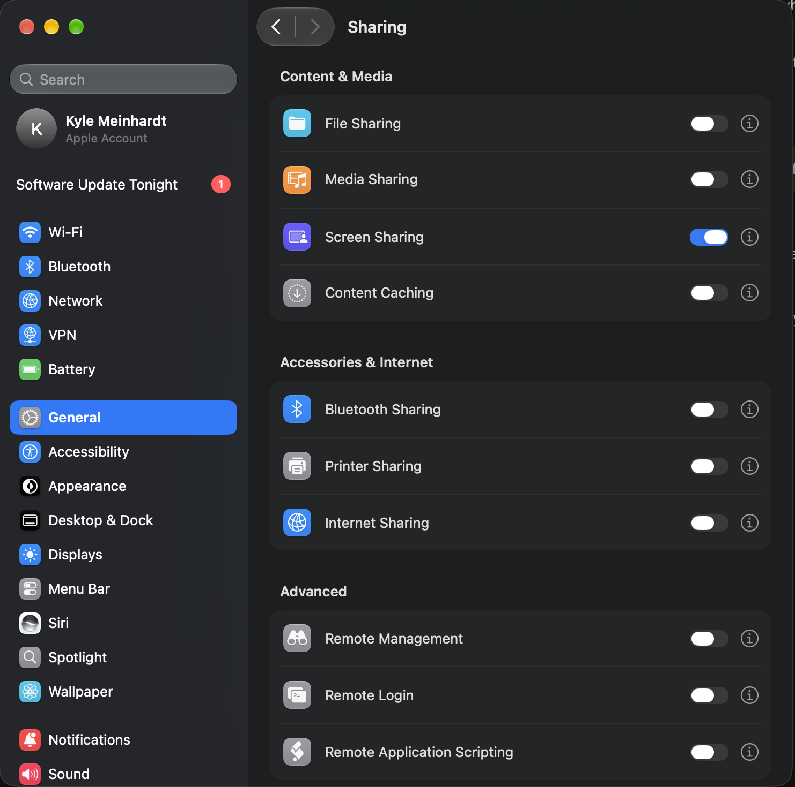
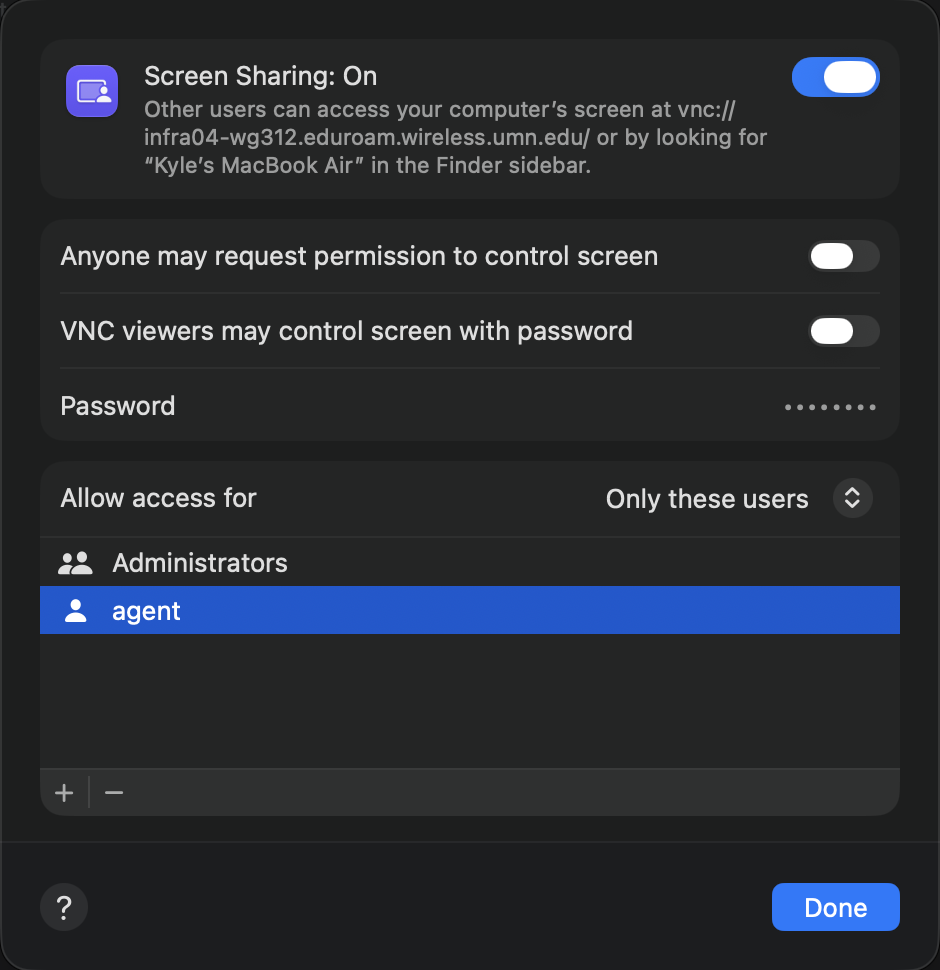
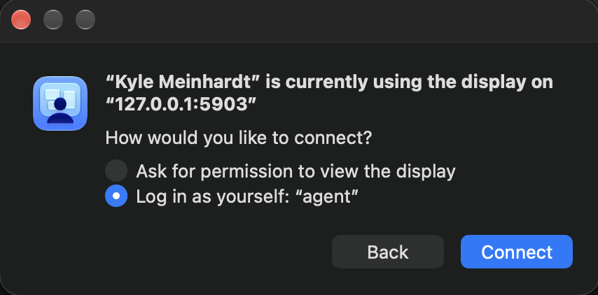

# Agent Desktop

Let Codex operate a separate macOS user desktop while you keep using your own. Agent Desktop connects directly to macOS Screen Sharing on the same Mac and exposes screenshots, clicks, typing, keyboard shortcuts, and scrolling through MCP. You can watch the agent work in Apple Screen Sharing, a read-only browser tab, or a terminal preview.

## Get started

You need an Apple silicon Mac, Xcode or Command Line Tools with Swift 6, Homebrew, Python 3.11 or newer, and Codex. The backend was tested on macOS 27.2. Runtime compatibility also depends on the macOS versions supported by your Homebrew libraries.

### Guided install

From your regular macOS account, clone the repository and run the installer in Terminal:

```sh
git clone https://github.com/kyle-meinhardt/agent-desktop.git
cd agent-desktop
bash scripts/install.sh
```

The installer checks dependencies, builds the app, and runs `agent-desktop setup`. Setup can create the standard `agent` account and add it to an existing Screen Sharing access group after you confirm each change. It pauses for first login on a new account and guides you through enabling Screen Sharing or adding `agent` in System Settings when needed. Enter the account password at the hidden prompt. Verify the preview belongs to `agent` before approving Codex input.

After verification, setup installs the Codex skill, registers the MCP if the name is available, and offers a Terminal shortcut through `~/.local/bin`. Rerun `./dist/agent-desktop setup` to resume. To inspect local prerequisites without making changes, run `./dist/agent-desktop setup --check`.

### Create the account separately

If Agent Desktop is already built, you can create just the standard macOS account:

```sh
./dist/agent-desktop create agent
```

Authorize the request as a macOS administrator, then enter the new account password at the hidden prompt. The command reuses an existing standard `agent` account with its current password. Log in to a new account once before running setup.

### 1. Prepare the separate account

Create a standard macOS user named `agent` in **System Settings → Users & Groups**. Log in to that account once to complete its setup, then return to your regular account. In **System Settings → General → Sharing → Screen Sharing**, enable Screen Sharing and allow the `agent` account. Use the account password for authentication. You can leave Remote Login off for this same-Mac connection.

<details>
<summary>Screen Sharing setup screenshots</summary>





</details>

### 2. Build Agent Desktop

```sh
git clone https://github.com/kyle-meinhardt/agent-desktop.git
cd agent-desktop
brew install cmake openssl@4
bash scripts/create-signing-identity.sh
bash scripts/build.sh
./dist/agent-desktop doctor
```

Create the local signing identity before configuring your session so future builds can retain Keychain access. macOS may prompt for permission to use the `Agent Desktop Local` signing key during the first build. Confirm the identity and tool in the prompt before approving it. The doctor command should report `sessionLibraryAvailable: true`.

### 3. Verify the desktop and enable input

```sh
./dist/agent-desktop configure agent
./dist/agent-desktop action agent screenshot --output /tmp/agent-desktop.png
open /tmp/agent-desktop.png
```

Enter the **agent account password** at the hidden prompt. The app stores it in Keychain. The default connection is `127.0.0.1:5900`. If Keychain asks whether Agent Desktop may access the saved credential, allow it for future connections. If the first screenshot times out while the session starts, retry the screenshot.

Inspect the image and confirm it belongs to the separate account before enabling input. If you see a login prompt, complete account setup and check again. The server must grant a virtual user session, and the screenshot confirms which desktop you reached.

```sh
./dist/agent-desktop approve agent
```

### 4. Add the server and skill to Codex

From the repository directory:

```sh
codex mcp add agent-desktop -- "$PWD/dist/agent-desktop" mcp agent
skill_root="${CODEX_HOME:-$HOME/.codex}/skills"
mkdir -p "$skill_root"
cp -R skills/agent-desktop "$skill_root/"
```

Start a new local Codex session and ask it to use **$agent-desktop** to take a screenshot and verify the separate account. Then give it a task to perform there. Keep this checkout in place because Codex launches the executable by its absolute path.

To disable input while retaining screenshots:

```sh
./dist/agent-desktop revoke agent
```

## Watch the agent work

To open the separate `agent` desktop in Apple Screen Sharing, run this from the checkout:

```sh
./dist/agent-desktop
```

The command starts a loopback-only relay at `127.0.0.1:5903` for your current macOS login. It requires a virtual session grant before it forwards screen data. Sign in with the `agent` account password. If prompted to choose a session, select **Log in as yourself: “agent”** and click **Connect**. Confirm you see the `agent` desktop, then switch to **Observe Mode**. Remote Login can stay off.



To make the command available as `agent-desktop` in zsh, add the absolute path to the built executable to your `~/.zshrc`:

```sh
alias agent-desktop='/absolute/path/to/agent-desktop/dist/agent-desktop'
```

To stop the relay and disconnect its viewers, run `launchctl remove local.agent-desktop.screen-forward`. The next launch starts it again. The relay supports the native RSA/SRP handshake and closes when it encounters an unsupported handshake or macOS denies the virtual session.

### Terminal and browser viewers

After configuring the session, run this from the checkout to watch directly in Apple Terminal or another interactive terminal with 256-color support:

```sh
./dist/agent-desktop watch agent --terminal
```

The preview uses colored characters and fits the current window. Press **Ctrl+C** to return to the shell. Use the browser view for fine text and full-color detail:

```sh
./dist/agent-desktop watch agent
```

Click the local URL printed in your terminal. In Apple Terminal, hold **Command** and double-click the URL. Leave the command running while you watch. The read-only view updates while the agent works through MCP. Press **Ctrl+C** in Terminal to close the viewer. The URL grants access to the read-only feed to anyone on the Mac who has it, so keep it private.

If you previously configured only the terminal-mac prototype, run the standalone `configure agent` command in step 3 first. The viewer uses Agent Desktop's own Keychain entry. You can keep the existing MCP registration while using the viewer.

## Scope

Agent Desktop uses a separate account on the same OS. Both accounts share system resources. The connection only accepts loopback addresses and requires a virtual user session grant. Screen Sharing stays enabled while the tool is in use. Input supports vertical scrolling and Basic Multilingual Plane text, including accented characters. Use a scrollbar drag for horizontal movement.

## Development and attribution

```sh
bash scripts/build-session-library.sh
swift test
python3 scripts/test-session-rfb.py
python3 scripts/test-screen-sharing-relay.py
```

The source retains attribution for the terminal-mac code used to develop the session backend. See the [license](LICENSE) and [third-party notices](THIRD_PARTY_NOTICES.md).
